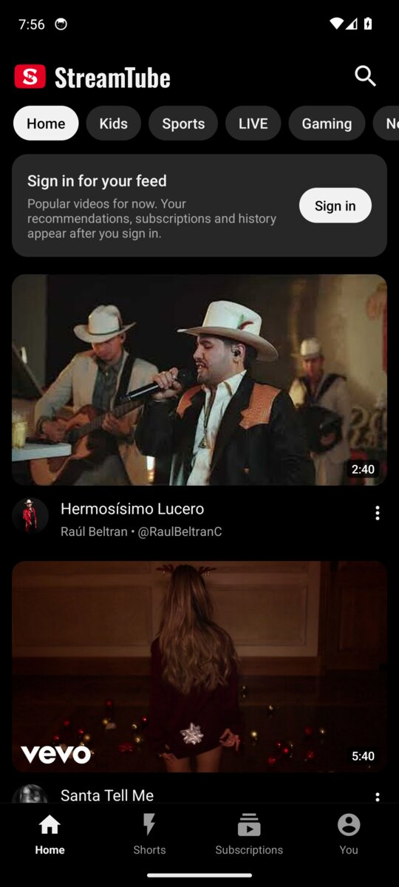
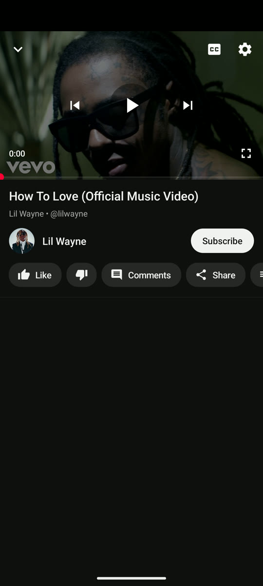
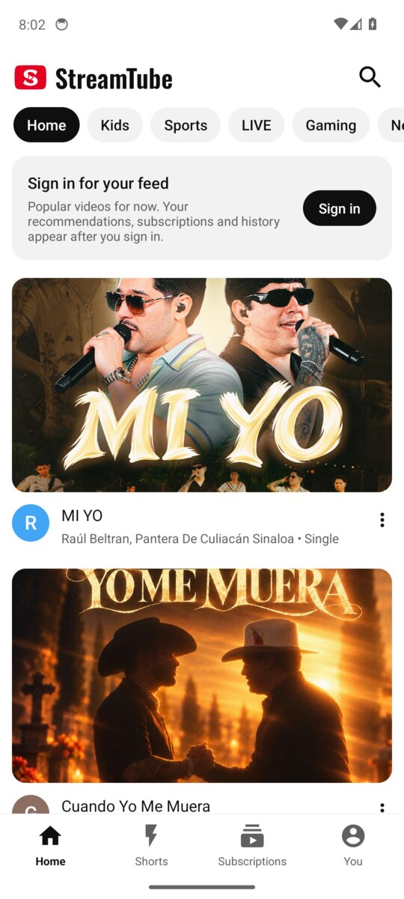
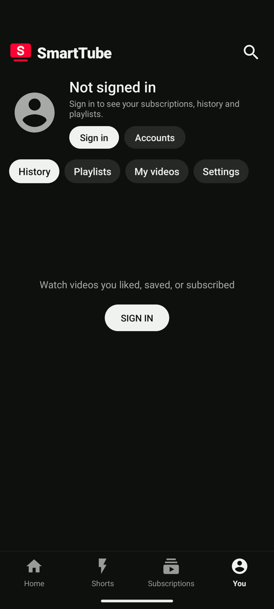
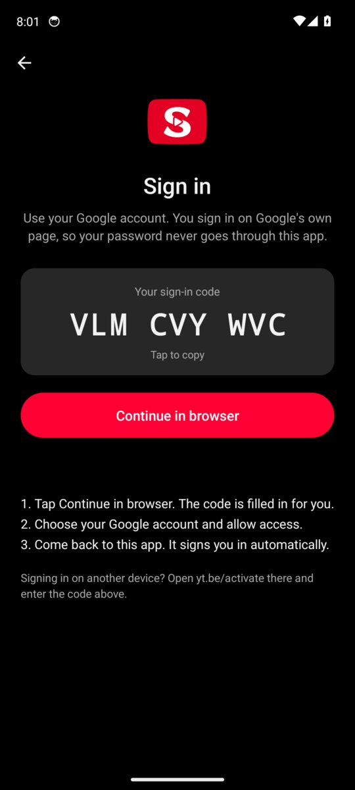
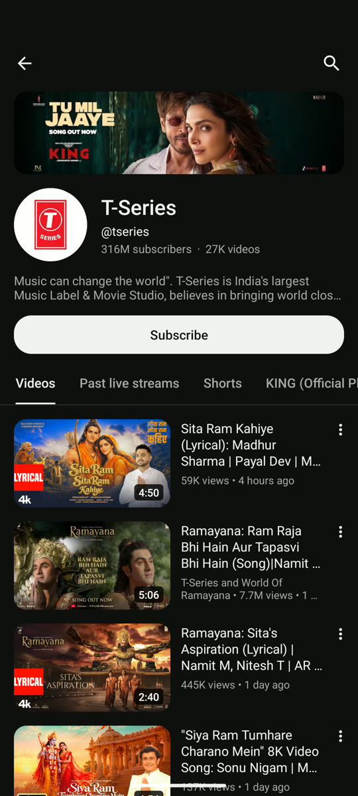
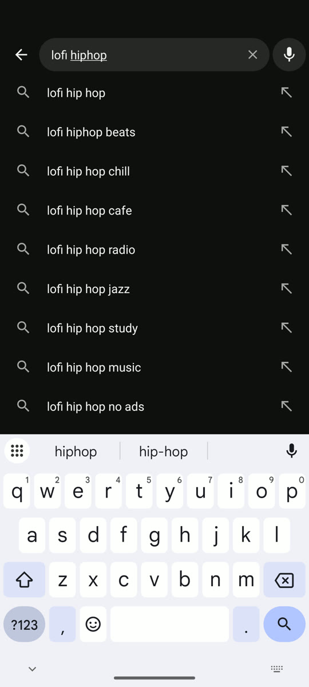
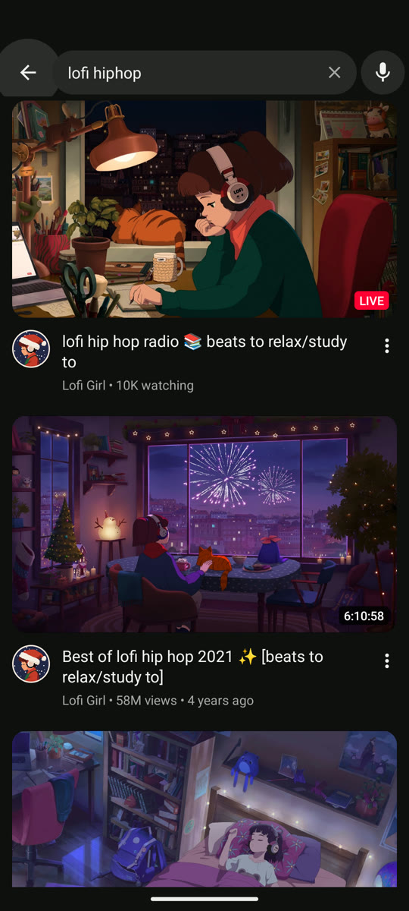
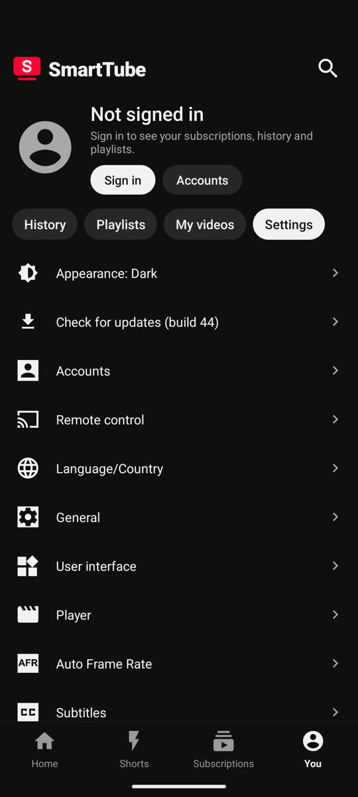

<p align="center">
  
</p>

<h1 align="center">SmartTube for phones</h1>

<p align="center">
  <b>An unofficial Android phone port of <a href="https://github.com/yuliskov/SmartTube">SmartTube</a>, the open-source YouTube client for Android TV.</b><br>
  Ad-free YouTube with a touch interface that looks and feels like the official app: portrait player,<br>
  swipeable Shorts, picture in picture, background play, and Dark or Light appearance.
</p>

<p align="center">
  <a href="https://github.com/shreyas-bangera/smarttube-phone/releases/latest/download/SmartTube-Phone-arm64.apk"><b>Download the latest APK</b></a>
  &nbsp;·&nbsp;
  <a href="https://github.com/shreyas-bangera/smarttube-phone/releases">All releases</a>
  &nbsp;·&nbsp;
  <a href="#credits">Credits</a>
</p>

<p align="center">
  
  
  
  
</p>

> [!NOTE]
> **This project is a port of [SmartTube](https://github.com/yuliskov/SmartTube) by [Yuriy Liskov](https://github.com/yuliskov) from Android TV to Android phones.**
> SmartTube was built for TVs and TV boxes and is controlled with a remote. This port keeps SmartTube's engine (the YouTube client, playback, sign in, SponsorBlock and settings) and replaces the TV interface with a touch interface designed for phones.
> It is an independent project, not affiliated with SmartTube's developer, YouTube or Google. For the TV app, visit the [original SmartTube repository](https://github.com/yuliskov/SmartTube).

---

## Contents

- [What it is](#what-it-is)
- [Features](#features)
- [Requirements](#requirements)
- [Install](#install)
- [Update to a new build](#update-to-a-new-build)
- [Connect your YouTube account](#connect-your-youtube-account)
- [How to use](#how-to-use)
  - [Home](#home)
  - [Watching a video](#watching-a-video)
  - [Full screen gestures](#full-screen-gestures)
  - [Mini player and background play](#mini-player-and-background-play)
  - [Shorts](#shorts)
  - [Channels](#channels)
  - [Search](#search)
  - [Subscriptions and the You tab](#subscriptions-and-the-you-tab)
  - [Settings and appearance](#settings-and-appearance)
- [Troubleshooting](#troubleshooting)
- [Privacy](#privacy)
- [Building from source](#building-from-source)
- [Credits](#credits)
- [License](#license)

---

## What it is

SmartTube for phones is a port of [SmartTube](https://github.com/yuliskov/SmartTube), the popular open-source YouTube client for Android TV, to Android phones.

The original SmartTube is designed for the big screen: it is navigated with a TV remote and does not support phones or tablets. This port brings it to phones by rebuilding the interface for touch, in portrait, held in one hand, while keeping SmartTube's proven core unchanged underneath:

| From SmartTube (unchanged) | New in this port |
| --- | --- |
| YouTube client and video playback | Phone interface with bottom tabs and topic chips |
| Ad-free viewing and SponsorBlock | Portrait player with details, comments and recommendations |
| Account sign in with a device code | Full screen vertical Shorts with swipe navigation |
| Quality up to 8K, 60 fps and HDR | Picture in picture and background play with notification controls |
| Settings, history, playlists and subscriptions | Touch gestures, phone search with voice input, Dark and Light appearance |

It installs as its own app (`org.smarttube.phone`), so it can sit next to the official YouTube app or SmartTube for TV without conflicts.

## Features

**Feels like YouTube**
- Bottom tabs: Home, Shorts, Subscriptions and You
- Topic chips on Home (Kids, Sports, LIVE, Gaming, News and more)
- Full-width video cards with channel pictures, and horizontal shelves
- Videos open with a smooth expand-from-thumbnail animation

**Player**
- Portrait player with the video on top and title, channel, buttons, comments and recommendations below
- Like, dislike, subscribe, share, save to a playlist, captions and quality, right under the video
- Comments with replies, readable in a sheet
- Rotate the phone (or tap the full screen button) for full screen
- Full screen gestures: double tap to skip, pinch to fill the screen, swipe for brightness and volume

**Updates**
- **Software update** screen (Settings, **Check for updates**): what's new, download progress and one-tap install, no browser needed
- Optional notice on Home when a new build is out

**Keep watching while you do other things**
- Drag the player down, or press back, to shrink it into a floating picture-in-picture window
- Background playback with a media notification (play, pause, next) for regular videos

**Shorts**
- Full screen vertical Shorts, swipe up for the next one and down for the previous one
- The Shorts tab starts playing straight away, with Shorts from all of YouTube (not only your subscriptions)
- Like, dislike, comments, share and save on the right side, like the official app

**From SmartTube**
- No ads
- SponsorBlock: skips sponsor segments, intros, outros and reminders to subscribe
- Up to 8K, 60 fps and HDR when your phone supports it
- Playback speed control
- Works without Google Play services

**Appearance**
- Dark (default), Light, or Same as device

## Requirements

- An Android phone with Android 8.0 or newer
- A 64-bit ARM processor (arm64-v8a). This covers almost every phone made since 2017, including all recent Samsung, Pixel, OnePlus, Xiaomi and Motorola phones.

## Install

1. On your phone, open this link: **[SmartTube-Phone-arm64.apk](https://github.com/shreyas-bangera/smarttube-phone/releases/latest/download/SmartTube-Phone-arm64.apk)**
2. When the download finishes, tap the notification (or open the file from your Downloads folder).
3. Android asks for permission to install apps from your browser the first time. Tap **Settings**, turn on **Allow from this source**, then go back.
4. Tap **Install**. If Google Play Protect warns about an unknown app, tap **More details** and then **Install anyway**. This warning appears for every app that is not from the Play Store.
5. Open **SmartTube** from your app drawer. Home shows popular videos straight away; you can sign in whenever you like.

When Android asks to allow notifications, tap **Allow**. The app uses the notification only for the background playback controls.

## Update to a new build

Each build is listed on the [releases page](https://github.com/shreyas-bangera/smarttube-phone/releases). The download link above always points to the newest one.

**From inside the app (recommended)**

1. Open the **You** tab, tap the **Settings** chip, then **Check for updates**. The **Software update** screen opens and checks right away. It shows the build you have.
2. If a newer build exists, it shows **Update available** with the build number, when it was released, the download size and a **What's new** list. Tap **Download and install**; a progress bar shows the download.
3. The first time, Android asks you to allow SmartTube to install apps: tap **Open settings**, turn on **Allow from this source** and come back. The update carries on by itself.
4. Android shows its usual confirmation. Tap **Update**. You stay signed in and all your settings are kept.

With **Notify me about new builds** turned on (on the same screen), SmartTube also checks every few hours and shows a small **Update** card on Home when a new build is out.

**Manually**

Download the latest APK from the link above and install it over the app you have. Android shows **Update** instead of Install.

> **On builds 39 to 51?** Those builds can't update themselves (older ones only have SmartTube's TV updater, newer ones download the update but never show Android's install prompt). Install the latest APK manually once; it installs over your current app and keeps your settings.

> **Coming from build 38 or older?** Those builds were signed with a temporary key, so Android refuses to install the new version over them ("App not installed" or "package conflicts with an existing package"). Uninstall the old SmartTube once (long press the icon, then **Uninstall**) and install the latest APK. Every update after that installs normally.

## Connect your YouTube account

You don't need an account to watch. Signing in adds your own recommendations on Home, your subscriptions, history, playlists and Watch later, and lets you like, subscribe and save.

SmartTube signs in the same way a smart TV does: the app shows a short code, and you approve it on Google's own website. **Your password is never typed into SmartTube** and never passes through it.

<p align="center">
  
  
</p>

**On the same phone**

1. Open the **You** tab (bottom right) and tap **Sign in**. You can also tap **Sign in** on the card at the top of Home.
2. SmartTube shows your sign-in code. Wait a moment until the code appears.
3. Tap **Continue in browser**. Your browser opens Google's device activation page (yt.be/activate) with the code already filled in. If it isn't, tap the code in SmartTube to copy it and paste it on the page.
4. Choose your Google account (sign in to Google if the browser asks) and tap **Allow** to give access to YouTube.
5. Switch back to SmartTube. It signs you in by itself within a few seconds. Your picture appears on the You tab and your own feed loads on Home.

**Using another device (a computer or a second phone)**

1. In SmartTube, open the **You** tab and tap **Sign in**.
2. On the other device, go to **yt.be/activate** (or youtube.com/activate) and enter the code shown in SmartTube.
3. Pick your account and tap **Allow**. SmartTube signs in on its own.

**More than one account**

- Add another account: **You** tab, **Accounts**, then add an account and repeat the steps above.
- Switch accounts: **You** tab, **Switch account**.
- Sign out or remove an account: **You** tab, **Accounts**.

**Remove the app's access from your Google account**

Go to [myaccount.google.com/permissions](https://myaccount.google.com/permissions), find the YouTube on TV entry and remove its access. SmartTube is signed out the next time it starts.

**If the code doesn't appear**

The app retries a few times on its own. If it still shows "Can't reach YouTube right now", check your internet connection. Private DNS, ad blocking DNS or VPN apps that block `youtube.com` or `google.com` also stop the code from loading. Tap **Try again** after fixing it.

## How to use

### Home

<p align="center">
  
</p>

- Scroll the feed and tap any video to play it.
- Tap a chip at the top (Kids, Sports, LIVE, Gaming, News) to switch topics.
- Tap a channel picture to open that channel.
- Tap the three dots next to a video for more options, such as adding it to a playlist or opening its channel.
- Top right: the search button.

### Watching a video

<p align="center">
  
</p>

- **Tap the video** to show or hide the controls: play and pause, previous and next, captions (CC), settings (quality, speed and more) and full screen.
- **Seek** by dragging along the red progress bar at the bottom of the video.
- **Double tap** the left or right side of the video to jump back or forward.
- **Below the video**: the title, the channel with its Subscribe button, and the buttons Like, Dislike, Comments, Share and Save. Scroll the row sideways for more.
- **Comments** opens a sheet; tap a comment's replies to read the thread.
- **Recommendations** are listed under the buttons. Tap one to play it.
- **Close the player**: tap the arrow at the top left, or drag the video down (it becomes the mini player, see below).

### Full screen gestures

Rotate the phone sideways, or tap the full screen button, to watch full screen. In full screen:

| Gesture | What it does |
| --- | --- |
| Tap | Show or hide the controls |
| Double tap on the left or right | Jump back or forward |
| Swipe up or down on the left half | Brightness |
| Swipe up or down on the right half | Volume |
| Pinch out | Zoom the video to fill the screen |
| Pinch in | Back to the original size |

Rotate back to portrait, or press back, to leave full screen.

### Mini player and background play

- **Drag the video down** (or press back) while a video plays: it shrinks into a small floating window and you are back on Home. Keep browsing while it plays.
- **Tap the floating window** for its controls; tap the expand button to open the player again, or the close button (or drag it to the bottom of the screen) to stop.
- **Open another video** while the mini player is showing: the new video replaces it.
- **Background play:** press the home button or lock the screen while a regular video plays and the sound keeps going. Use the media notification (or the lock screen) to play, pause or skip. Shorts don't play in the background.

### Shorts

<p align="center">
  
</p>

- Tap the **Shorts** tab: the first Short starts playing right away, full screen.
- **Swipe up** for the next Short, **swipe down** for the previous one. More Shorts keep loading as you go.
- **Tap** to pause or resume.
- On the right: **Like**, **Dislike**, **Comments**, **Share**, **Save** and more options. At the bottom: the channel (tap it to open the channel), **Subscribe** and the title.
- Press back (or tap the arrow at the top left) to return to Home.

### Channels

<p align="center">
  
</p>

- Tap a channel picture or name anywhere to open the channel.
- The top shows the channel's banner, picture, name, handle, subscriber and video counts, and its description (tap it to read all of it). **Subscribe** is right below.
- Tabs switch between **Videos**, **Shorts**, **Live**, **Playlists** and the channel's other sections. Videos are a list (thumbnail on the left), Shorts a grid. More load as you scroll.

### Search

<p align="center">
  
  
</p>

- Tap the **magnifying glass** at the top of Home.
- Type to see live suggestions, then tap a suggestion or press search on the keyboard.
- Tap the **microphone** to search by voice.
- Results include videos, channels and playlists.

### Subscriptions and the You tab

- **Subscriptions** shows the latest videos from the channels you follow, with a strip of your channels on top (sign in first).
- **You** shows your account at the top (Sign in, or Switch account once signed in, and Accounts). Below it, the chips **History**, **Playlists** (including Watch later and liked videos), **My videos** and **Settings**.

### Settings and appearance

<p align="center">
  
  
</p>

Open the **You** tab and tap the **Settings** chip.

- **Appearance** is the first setting. Tap it to cycle between **Dark**, **Light** and **Same as device**. The app switches immediately.
- **Check for updates** is the second setting. It opens the Software update screen (see [Update to a new build](#update-to-a-new-build)).
- Everything else is SmartTube's own settings, for example:
  - **Player**: default quality, playback speed, captions style, autoplay
  - **SponsorBlock**: choose which segment types are skipped
  - **General**: background playback, history, hidden sections
  - **Accounts**: add, switch or remove accounts

## Troubleshooting

**"App not installed" when installing a new build**
You probably have one of the early builds signed with a temporary key. Uninstall it once, then install the latest APK. See [Update to a new build](#update-to-a-new-build).

**Install is blocked**
Allow your browser or file manager to install unknown apps (Settings, Apps, Special app access, Install unknown apps), and choose **Install anyway** if Play Protect warns.

**The sign-in code doesn't appear**
Check the connection, and turn off Private DNS, ad blocking DNS or VPN apps that block YouTube or Google, then tap **Try again**.

**"Sign in to confirm you're not a bot"**
YouTube sometimes asks this on shared or busy networks, and with VPNs. Signing in usually fixes it; switching between Wi-Fi and mobile data can help too.

**Videos buffer a lot**
Open the player settings and pick a lower quality, or turn off high frame rate. A different video format (codec) in the player settings can also help on older phones.

**No sound in the background**
Allow the app's notification, and check your phone's battery settings. On OnePlus, Xiaomi, Samsung and similar phones, set SmartTube's battery usage to **Unrestricted** so Android doesn't stop it.

**The app crashed**
When it opens again it offers a crash report. Please [open an issue](https://github.com/shreyas-bangera/smarttube-phone/issues) with the report and the steps that led to it.

## Privacy

- No ads and no tracking added by this app.
- Sign in happens on Google's website; the app never sees your password. It keeps only the access token Google gives it, on your phone.
- The app talks to YouTube, and to SponsorBlock if it is turned on. See [PRIVACY.md](PRIVACY.md) for SmartTube's privacy notes.

## Building from source

The phone app is the Gradle flavor `stphone` of the SmartTube project. The phone code lives in [`smarttubetv/src/stphone/`](smarttubetv/src/stphone/); the rest is the SmartTube codebase.

Builds run in GitHub Actions ([`.github/workflows/phone.yml`](.github/workflows/phone.yml)), which also applies the phone changes to the `MediaServiceCore` submodule from [`.github/patches/`](.github/patches/). To build locally with JDK 17 and the Android SDK:

```bash
git clone --recursive https://github.com/shreyas-bangera/smarttube-phone.git
```

```bash
cd smarttube-phone && git -C MediaServiceCore apply --ignore-whitespace .github/patches/mediaservicecore.patch
```

```bash
./gradlew assembleStphoneRelease
```

## Credits

This app exists because of **[SmartTube](https://github.com/yuliskov/SmartTube)** by **[Yuriy Liskov (yuliskov)](https://github.com/yuliskov)** and its contributors. Everything under the hood comes from their work: the YouTube client, sign in, playback, SponsorBlock, settings and much more. This project only adds a phone interface on top.

If you enjoy this app, please support the original project:
- Star [SmartTube on GitHub](https://github.com/yuliskov/SmartTube)
- Donate to the SmartTube developer through the links in the [SmartTube README](https://github.com/yuliskov/SmartTube#donation)
- Visit the [SmartTube website](https://smarttubeapp.github.io)

Thanks also to:
- [SponsorBlock](https://sponsor.ajay.app/) for the crowd-sourced segment data
- [ExoPlayer](https://github.com/google/ExoPlayer) for playback
- Everyone who contributed code and translations to SmartTube

SmartTube for phones is an unofficial project. It is not made by, or affiliated with, SmartTube's developer, YouTube or Google. Please report problems with this phone app [here](https://github.com/shreyas-bangera/smarttube-phone/issues), not to the SmartTube project.

## License

MIT, the same as SmartTube. See [LICENSE](LICENSE). Copyright (c) 2020-present yuliskov, phone edition changes by [shreyas-bangera](https://github.com/shreyas-bangera).
