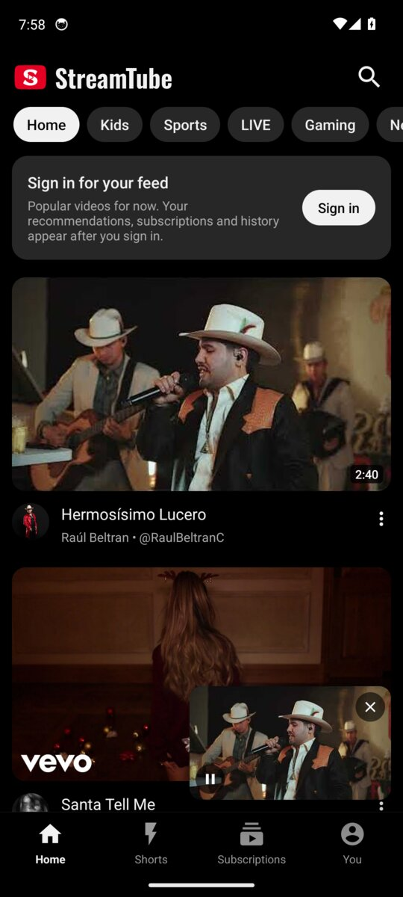
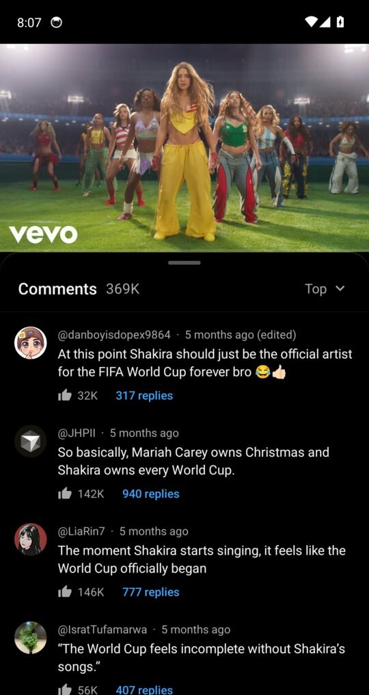

<p align="center">
  <picture>
    <source media="(prefers-color-scheme: dark)" srcset="images/brand/streamtube-logo-dark.png">
    
  </picture>
</p>

<p align="center">
  <b>Ad-free YouTube for Android phones.</b><br>
  A touch app that looks and feels like the official one: portrait player, an in-app mini player, swipeable Shorts,<br>
  comments you can write and delete, downloads, background play, SponsorBlock, and Dark or Light appearance.
</p>

<p align="center">
  <a href="https://github.com/shreyas-bangera/smarttube-phone/releases/latest/download/StreamTube-arm64.apk"><b>Download the latest APK</b></a>
  &nbsp;·&nbsp;
  <a href="https://github.com/shreyas-bangera/smarttube-phone/releases">All releases</a>
  &nbsp;·&nbsp;
  <a href="#install">How to install</a>
</p>

<p align="center">
  
  
  
  
</p>

> [!NOTE]
> **StreamTube is a port of [SmartTube](https://github.com/yuliskov/SmartTube) to Android phones.**
> SmartTube, by [Yuriy Liskov](https://github.com/yuliskov), is the popular open-source YouTube client for Android TV, made for the big screen and a TV remote. StreamTube keeps SmartTube's engine (the YouTube client, playback, sign in, SponsorBlock and settings) and replaces the TV interface with a touch interface built for phones.
> It is an independent project, not affiliated with SmartTube's developer, YouTube or Google. For the TV app, visit the [SmartTube repository](https://github.com/yuliskov/SmartTube).

---

## Contents

- [Features](#features)
- [Requirements](#requirements)
- [Install](#install)
- [Update to a new build](#update-to-a-new-build)
- [Connect your YouTube account](#connect-your-youtube-account)
- [How to use](#how-to-use)
  - [Home](#home)
  - [Watching a video](#watching-a-video)
  - [Comments](#comments)
  - [Mini player and background play](#mini-player-and-background-play)
  - [Full screen gestures](#full-screen-gestures)
  - [Shorts](#shorts)
  - [Channels](#channels)
  - [Search](#search)
  - [Subscriptions and the You tab](#subscriptions-and-the-you-tab)
  - [Settings and appearance](#settings-and-appearance)
- [Troubleshooting](#troubleshooting)
- [Privacy](#privacy)
- [Building from source](#building-from-source)
- [Credits](#credits)
- [License](#license)

---

## Features

**Feels like YouTube**
- Bottom tabs: Home, Shorts, Subscriptions and You
- Topic chips on Home (Kids, Sports, LIVE, Gaming, News and more)
- Full-width video cards with channel pictures, and horizontal shelves
- Videos open with a smooth expand-from-thumbnail animation

**Player**
- Portrait player: the video on top, then the title, channel, buttons, comments and recommendations
- Like, dislike, subscribe, share, download, save to a playlist, captions, quality and playback speed
- Rotate the phone (or tap the full screen button) for full screen, with gestures for seeking, brightness, volume and zoom
- Videos start quickly: 1080p by default on phones, and nothing extra is loaded before the first frame

**Mini player**
- Swipe the video down, or press Back: it shrinks into a small player at the bottom right of the screen and keeps playing while you browse Home, Search or a channel
- Drag it anywhere, tap it to go back to the full player, close it with X
- Background play with media controls in the notification and on the lock screen

**Comments**
- Total count, Top or Newest first, and reply threads
- Write comments and replies when signed in
- Long press your own comment or reply to delete it

**Downloads**
- Save a video from 1080p down to 360p (MP4), or audio only (M4A), to **Download/StreamTube**

**Shorts**
- Full screen vertical Shorts: swipe up for the next one, down for the previous one
- Like, dislike, comments, share and save on the right side, like the official app

**No ads, and more**
- No ads, and no tracking added by the app
- SponsorBlock skips sponsor segments, intros, outros and reminders to subscribe
- Up to 8K, 60 fps and HDR when your phone supports it
- Works without Google Play services
- Dark (pure black for AMOLED screens), Light, or Same as device
- Built-in updater: see what's new and install new builds from inside the app
- A small download (about 29 MB)

## Requirements

- An Android phone with Android 8.0 or newer (the in-app mini player needs Android 11 or newer; older versions use a floating window instead)
- A 64-bit ARM processor (arm64-v8a). This covers almost every phone made since 2017, including all recent Samsung, Pixel, OnePlus, Xiaomi and Motorola phones.

It installs as its own app, so it can sit next to the official YouTube app without conflicts.

## Install

1. On your phone, open this link: **[StreamTube-arm64.apk](https://github.com/shreyas-bangera/smarttube-phone/releases/latest/download/StreamTube-arm64.apk)**
2. When the download finishes, tap the notification (or open the file from your Downloads folder).
3. The first time, Android asks for permission to install apps from your browser. Tap **Settings**, turn on **Allow from this source**, then go back.
4. Tap **Install**. If Google Play Protect warns about an unknown app, tap **More details** and then **Install anyway**. This warning appears for apps that don't come from the Play Store.
5. Open **StreamTube** from your app drawer. Home shows popular videos straight away; you can sign in whenever you like.

When Android asks to allow notifications, tap **Allow**. StreamTube uses notifications only for the background playback controls (also shown on the lock screen) and, if you want, to tell you about new builds.

## Update to a new build

Each build is listed on the [releases page](https://github.com/shreyas-bangera/smarttube-phone/releases). The download link above always points to the newest one.

**From inside the app (recommended)**

1. Open the **You** tab, tap the **Settings** chip, then **Check for updates**. The **Software update** screen shows the build you have and checks right away.
2. If a newer build exists, it shows **Update available** with the build number, the download size and a **What's new** list. Tap **Download and install**; a progress bar shows the download.
3. The first time, Android asks you to allow StreamTube to install apps: tap **Open settings**, turn on **Allow from this source** and come back. The update carries on by itself.
4. Android shows its usual confirmation. Tap **Update**. You stay signed in and your settings are kept.

With **Notify me about new builds** turned on (on the same screen), StreamTube checks every few hours and shows a small **Update** card on Home when a new build is out.

**Manually**

Download the latest APK from the link above and install it over the app you have. Android shows **Update** instead of Install.

> **On builds 39 to 51?** Those builds can't update themselves. Install the latest APK manually once; it installs over your current app and keeps your settings.

> **Coming from build 38 or older?** Those builds were signed with a temporary key, so Android refuses to install over them ("App not installed"). Uninstall the old app once (long press the icon, then **Uninstall**) and install the latest APK. Every update after that installs normally.

## Connect your YouTube account

You don't need an account to watch. Signing in adds your own recommendations on Home, your subscriptions, history, playlists and Watch later, and lets you like, subscribe, save and comment.

StreamTube signs in the same way a smart TV does: the app shows a short code and you approve it on Google's own website. **Your password is never typed into StreamTube** and never passes through it.

<p align="center">
  
  
</p>

**On the same phone**

1. Open the **You** tab (bottom right) and tap **Sign in**. You can also tap **Sign in** on the card at the top of Home.
2. Wait a moment until StreamTube shows your sign-in code.
3. Tap **Continue in browser**. Google's device activation page (yt.be/activate) opens with the code filled in. If it isn't, tap the code in StreamTube to copy it and paste it on the page.
4. Choose your Google account and tap **Allow**.
5. Switch back to StreamTube. It signs you in by itself within a few seconds.

**Using another device**

1. In StreamTube, open the **You** tab and tap **Sign in**.
2. On a computer or another phone, go to **yt.be/activate** and enter the code shown in StreamTube.
3. Pick your account and tap **Allow**. StreamTube signs in on its own.

**More than one account**

- Add another account: **You** tab, **Accounts**, then add an account and repeat the steps above.
- Switch accounts: **You** tab, **Switch account**.
- Sign out or remove an account: **You** tab, **Accounts**.

To remove the app's access from your Google account, go to [myaccount.google.com/permissions](https://myaccount.google.com/permissions) and remove the YouTube on TV entry.

## How to use

### Home

<p align="center">
  
</p>

- Scroll the feed and tap any video to play it.
- Tap a chip at the top (Kids, Sports, LIVE, Gaming, News) to switch topics.
- Tap a channel picture to open that channel, or the three dots next to a video for more options.
- Top right: search.

### Watching a video

<p align="center">
  
</p>

- **Tap the video** to show or hide the controls: play and pause, previous and next, playback speed, captions (CC), settings (quality and more) and full screen.
- **Seek** by dragging the red progress bar, or **double tap** the left or right side to jump back or forward.
- **Below the video**: the title, the channel with its Subscribe button, then Like, Dislike, Comments, Share, Download and Save. Scroll the row sideways for more.
- **Download**: pick a quality from **1080p** to **360p** (MP4) or **Audio only (M4A)**. It downloads in the background with a progress notification and is saved to **Download/StreamTube**. Live streams can't be downloaded.
- **Recommendations** are listed under the buttons. Tap one to play it.
- **Leave the player**: swipe the video down or press Back. It becomes the [mini player](#mini-player-and-background-play) and keeps playing.

### Comments

<p align="center">
  
</p>

- Tap **Comments** under the video. The sheet shows the total count and a **Top / Newest** switch. Tap a comment's replies to read the thread.
- **Write**: when signed in, type in the bar at the bottom and tap send. Your comment (or reply, inside a thread) appears on top right away.
- **Delete**: long press one of your own comments or replies, then **Delete**.

### Mini player and background play

<p align="center">
  
</p>

- **Swipe the video down** (or press Back): it shrinks into a small player at the bottom right of the screen you came from, and the video keeps playing while you browse Home, Search or a channel.
- **Drag** the mini player anywhere; it settles against the nearest side. It always starts at the bottom right.
- **Tap** it to open the full player again. **X** closes it; the small button pauses or plays.
- **Open another video** while it plays: the new video opens in the full player.
- **Background play**: press the home button or lock the screen while a video plays and the sound keeps going. The notification and the lock screen show play and pause controls. Shorts don't play in the background.

### Full screen gestures

Rotate the phone sideways, or tap the full screen button. In full screen:

| Gesture | What it does |
| --- | --- |
| Tap | Show or hide the controls |
| Double tap on the left or right | Jump back or forward |
| Swipe up or down on the left half | Brightness |
| Swipe up or down on the right half | Volume |
| Pinch out | Zoom the video to fill the screen |
| Pinch in | Back to the original size |

Rotate back to portrait, or press Back, to leave full screen.

### Shorts

<p align="center">
  
</p>

- Tap the **Shorts** tab: the first Short starts playing right away, full screen.
- **Swipe up** for the next Short, **swipe down** for the previous one. **Tap** to pause or resume.
- On the right: **Like**, **Dislike**, **Comments**, **Share** and **Save**. At the bottom: the channel (tap it to open the channel), **Subscribe** and the title.

### Channels

<p align="center">
  
</p>

- Tap a channel picture or name anywhere to open the channel: banner, picture, name, handle, subscriber and video counts, description and **Subscribe**.
- Tabs switch between **Videos**, **Shorts**, **Live**, **Playlists** and the channel's other sections.

### Search

<p align="center">
  
  
</p>

- Tap the **magnifying glass** at the top of Home, type to see live suggestions, or tap the **microphone** to search by voice.
- Results include videos, channels and playlists.

### Subscriptions and the You tab

- **Subscriptions** shows the latest videos from the channels you follow (sign in first). On top, a row of your channels with a blue dot on the ones with new videos; tap a channel to see only its videos, tap it again to see all. The chips **All**, **Today**, **Videos**, **Shorts** and **Live** filter the feed.
- **You** shows your account (Sign in, Switch account, Accounts), then the chips **History**, **Playlists** (including Watch later and liked videos), **My videos** and **Settings**.

### Settings and appearance

<p align="center">
  
  
</p>

Open the **You** tab and tap the **Settings** chip.

- **Appearance**: tap it to cycle between **Dark**, **Light** and **Same as device**. The app switches immediately.
- **Notifications**: shows whether notifications are on; tap it to allow them.
- **Check for updates**: opens the Software update screen (see [Update to a new build](#update-to-a-new-build)).
- **About**: version, links and credits.
- Below them, the full player and app settings: default quality, playback speed, captions style, autoplay, SponsorBlock segments, background playback, history, accounts and more.

## Troubleshooting

**"App not installed" when installing a new build**
You probably have one of the early builds signed with a temporary key. Uninstall it once, then install the latest APK. See [Update to a new build](#update-to-a-new-build).

**Google Play Protect says "Harmful app blocked"**
Play Protect checks apps installed from outside the Play Store and sometimes flags open-source apps by mistake. StreamTube's source code is public in this repository, and every build is made and signed by GitHub Actions from that code. Tap **Install anyway** (on some phones under **More details**).

**The sign-in code doesn't appear**
Check the connection, and turn off Private DNS, ad-blocking DNS or VPN apps that block YouTube or Google, then tap **Try again**.

**"Sign in to confirm you're not a bot"**
YouTube sometimes asks this on shared or busy networks and with VPNs. Signing in usually fixes it; switching between Wi-Fi and mobile data can help too.

**Videos buffer a lot**
Open the player settings and pick a lower quality (1080p is the default on phones), or turn off high frame rate.

**No sound in the background, or no controls on the lock screen**
Turn on notifications (**You**, **Settings**, **Notifications**) and check your phone's battery settings. On OnePlus, Xiaomi, Samsung and similar phones, set StreamTube's battery usage to **Unrestricted**.

**The app crashed**
When it opens again it offers a crash report. Please [open an issue](https://github.com/shreyas-bangera/smarttube-phone/issues) with the report and the steps that led to it.

## Privacy

- No ads, and no tracking added by the app.
- Sign in happens on Google's website; the app never sees your password. It keeps only the access token Google gives it, on your phone.
- The app talks to YouTube, to GitHub when it checks for updates, and to SponsorBlock if it is turned on. See [PRIVACY.md](PRIVACY.md).

## Building from source

StreamTube is the Gradle flavor `stphone`. The phone code lives in [`smarttubetv/src/stphone/`](smarttubetv/src/stphone/).

Every push to `main` is built and released by GitHub Actions ([`.github/workflows/phone.yml`](.github/workflows/phone.yml)), which also applies the phone changes to the `MediaServiceCore` submodule from [`.github/patches/`](.github/patches/). Pull requests are built and tried on an emulator first ([`.github/workflows/pr-check.yml`](.github/workflows/pr-check.yml)). To build locally with JDK 17 and the Android SDK:

```bash
git clone --recursive https://github.com/shreyas-bangera/smarttube-phone.git
```

```bash
cd smarttube-phone && git -C MediaServiceCore apply --ignore-whitespace ../.github/patches/mediaservicecore.patch
```

```bash
./gradlew assembleStphoneRelease
```

## Credits

StreamTube is a port of [SmartTube](https://github.com/yuliskov/SmartTube) by Yuriy Liskov and its contributors. Their engine (the YouTube client, sign in, playback, SponsorBlock and settings) runs underneath, with a phone interface on top. If you enjoy StreamTube, please star [SmartTube](https://github.com/yuliskov/SmartTube) too. Thanks also to [SponsorBlock](https://sponsor.ajay.app/) and [ExoPlayer](https://github.com/google/ExoPlayer).

StreamTube is an independent project, not affiliated with YouTube or Google. Please report problems [here](https://github.com/shreyas-bangera/smarttube-phone/issues).

## License

MIT. See [LICENSE](LICENSE).
